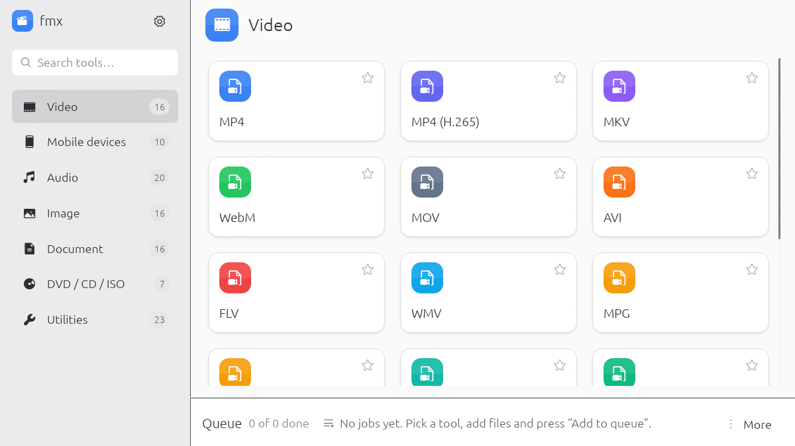
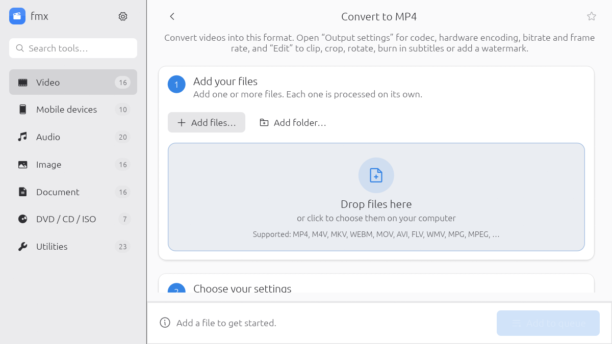
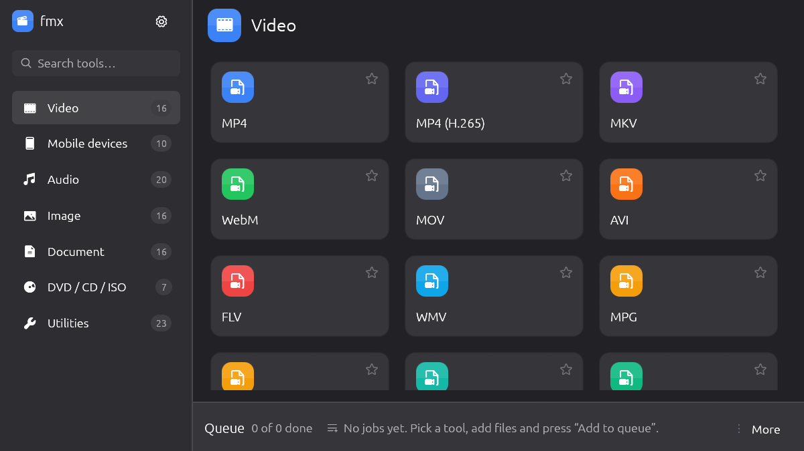

# FMX | Free Media Xpress

<!-- coderabbit-ai-generated:v1 -->

<!-- coderabbit-ai-generated-section:v1:154c851f19889f30a59fededf1a4f8cd2fe955bab881474522ec5a8a7136a907 -->

FMX is a free, open-source desktop app for converting video, audio, images,
documents and discs on Windows, macOS and Linux. Add your files, choose a format
and let the queue do the work. FFmpeg and yt-dlp are included for common
conversions and video downloads.

[**Visit the FMX website**](https://fmx-dun.vercel.app/) ·
[Download the latest release](https://github.com/sudo-py-dev/fmx/releases/latest) ·
[Getting started](#-your-first-conversion) ·
[Build and contribute](DEVELOPMENT.md) ·
[Report a problem](https://github.com/sudo-py-dev/fmx/issues)

<!-- /coderabbit-ai-generated:v1 -->

<!-- coderabbit-ai-generated:v1 -->

<!-- coderabbit-ai-generated-section:v1:2c0389bb00b7bc9843b9d80e65ab69c9f994f6fc229a31adb63d3395143b61fa -->

## Highlights

- **Convert in batches:** Queue files or folders and process several jobs in parallel.
- **Make it yours:** Use device presets or adjust output settings and edit before converting.
- **Find tools quickly:** Browse by task, search all categories and pin favorites.
- **Edit and clean up:** Improve recordings, edit music tags and cover art, and remove photo metadata.
- **Work from your file manager:** Convert using the right-click menu on Windows and Linux.
- **Choose your look and language:** Use light or dark mode and select English, Español, Français, Deutsch, עברית or Русский. Hebrew uses a mirrored layout.
- **Get started freely:** No ads or account required.

## Contents

- [Download and install](#-download-and-install) · [Your first conversion](#-your-first-conversion)
- [Conversion and editing tools](#-conversion-and-editing-tools) · [Video downloader](#-video-downloader) · [Right-click conversion](#%EF%B8%8F-convert-with-a-right-click)
- [Appearance](#-appearance) · [Updates](#-updates) · [Optional programs](#-optional-programs)
- [Troubleshooting](#%EF%B8%8F-troubleshooting) · [License](#-license)

<!-- /coderabbit-ai-generated:v1 -->

## 📦 Download and install

Get the file for your computer from the [**latest release**](https://github.com/sudo-py-dev/fmx/releases/latest):

| Your computer | Download | Then |
|---|---|---|
| **Windows 10 / 11** (64-bit) | `…-windows-x64-setup.exe` | Double-click it and follow the steps. |
| **macOS 11+** (Intel or Apple silicon) | `…-macos-universal.dmg` | Open it and drag FMX to Applications. |
| **Ubuntu / Debian** | `…_amd64.deb` | Double-click it to install, or run `sudo apt install ./fmx_*_amd64.deb` |
| **Other Linux** (x86-64) | `…-linux-x86_64.tar.gz` | Unpack it, open the extracted folder, and run `./fmx`. Keep the `tools/` folder beside it. |

> **Windows says "Windows protected your PC"?** Click **More info → Run anyway**. The installer may trigger an unknown-publisher warning.
>
> **Mac says FMX "can't be opened"?** Right-click FMX in Applications and choose **Open** the first time.

---

## 🚀 Your first conversion

1. **Pick a format.** Choose a category on the left, then a format such as **MP4** or **MP3**.
2. **Add files.** Drag them into the window or click **Add files**.
3. **Check the output folder.** Choose where to save the converted files.
4. **Click Add to queue.** If automatic start is off, click **Start** in the queue.

The default settings work well for most people. If you want more control, open **Output settings** or **Edit** to trim, crop, rotate or add subtitles.

Choose what happens when the queue finishes: play a sound, show a notification,
open the output folder or shut down the computer.

---

## 🧰 Conversion and editing tools

| Category | What you can do |
|---|---|
| 🎬 **Video** | Convert to MP4, MKV, WebM, MOV, AVI, GIF and more. Join, crop or rotate clips, add subtitles or a watermark, stabilize, denoise or sharpen video, and make thumbnail sheets. |
| 📱 **Phones & devices** | Ready-made settings for iPhone, iPad, Android, smart TVs, YouTube, WhatsApp, PlayStation and Xbox. |
| 🎵 **Audio** | Convert to MP3, M4A, FLAC, WAV, OGG and more. Extract audio, make iPhone ringtones, edit tags and cover art, reduce noise or vocals, trim silence, and create waveform or spectrum videos. |
| 🔧 **Edit media** | Trim, split, change speed, reverse or fade video and audio. Inspect media details or repair files. |
| 🖼️ **Images** | Convert to JPG, PNG, WebP and more. Resize, rotate, make black-and-white, combine images or remove photo metadata. Opens iPhone (HEIC) photos. |
| 📄 **Documents** | Pictures → PDF, PDF → Word, Excel or pictures, Word/Excel/PowerPoint → PDF. Merge, split and shrink PDFs. Convert eBooks. |
| 💿 **Discs & ISO** | Copy DVDs and Blu-rays to video files, rip music CDs, and make or open ISO disc images. |
| 📥 **Download & record** | Download videos from a link, record your screen, record microphone and system audio, or take a screenshot. |

Tools are grouped by task within each category, with less common formats under
**More** groups. Search matches tools across all categories; press **Ctrl+F**
(**⌘F** on macOS) to focus it. The search field stays within the sidebar while
typing long queries or clearing the text.

To add subtitle tracks in a batch, open **Add subtitle track**, add videos or use
**Add folder**, and enable **Match subtitles by filename**. Each video needs one
SRT, ASS, SSA or VTT file in the same folder with exactly the same name before
the extension, including capitalization (for example `clip.mp4` and `clip.srt`).
If a match is missing or multiple files match, fix the filenames before queueing.
Leave matching off to use one chosen subtitle file for every selected video.

### Tags, privacy and media details

- **Edit tags and cover art** loads each file's existing tags so you can edit files
  individually. Update title, artist, album, track numbers, lyrics and other tags,
  or replace or remove cover art. Save as MP3, M4A or FLAC; matching audio formats
  are copied without re-encoding. FMX saves a new file and verifies the saved tags
  before publishing the result. Tag support depends on the output format.
- **Remove photo metadata** strips embedded EXIF/GPS and other metadata from still
  JPEG, PNG, WebP and BMP images. It applies photo rotation and saves clean PNG
  copies, keeping the originals unchanged.
- **Media info** shows container, bitrate, codecs and stream details without
  creating an output file.

Vocal reduction uses sounds shared by the left and right channels; results depend
on the recording and stronger settings can weaken instruments too. Maximum
reduction makes mono audio silent. Reverse works best with short clips because it
holds the clip in memory; trimming silence also buffers audio to trim its end.

<b>Format reference</b>

**Video:** MP4 (H.264 · H.265) · MKV · WebM · MOV · AVI · FLV · WMV · MPG · VOB · TS · OGV · 3GP · SWF · GIF · Animated WebP

**Audio:** MP3 · AAC · M4A · M4R ringtone · FLAC · WAV · OGG · Opus · WMA · AIFF · AC3 · MP2 · WavPack · MKA · MMF · AMR · APE · ALAC (Apple Lossless) · CAF · AU

**Image:** PNG · JPG · WebP · BMP · TIFF · GIF · ICO · TGA · QOI · AVIF · JPEG XL · PCX · PPM · PGM · PAM

**Documents:** PDF · Word · Excel · TXT · HTML · EPUB · FB2 · MOBI / AZW3 (with Calibre)

**Discs:** DVD · Blu-ray · Music CD · ISO · CSO

---

## 📥 Video downloader

Paste a video, playlist or channel link from YouTube, X (Twitter), Vimeo, TikTok,
or another [site supported by yt-dlp](https://github.com/yt-dlp/yt-dlp/blob/master/supportedsites.md).
Site support depends on the bundled yt-dlp version and the site's current restrictions.

1. Open the video downloader and paste a link.
2. Choose what to save: **video**, **audio**, **subtitles**, **thumbnail** or **metadata**.
3. For video or audio, choose the format and quality.
4. Check the output folder and add the download to the queue.

<b>More download options</b>

Open **More download options** for:

- Playlist indices and slices (`1:5,8` selects items 1 through 5 and item 8).
- A clip's start and end in seconds, or an open-ended range.
- Separate files for the video's chapters, while retaining the complete download.
- SponsorBlock removal of sponsored segments using community timestamps.
- A download history in the output folder to skip completed media. Histories are
  separated by media kind, format, quality, clip range and chapter/sponsor choices.
- Live streams from the beginning, where supported. Recording continues until
  the stream finishes or the job is cancelled.
- Automatic captions and separate subtitle, thumbnail, JSON metadata and description files.
- Parallel DASH/HLS fragments and retry counts.
- A Netscape-format cookies file for signed-in access; the same file is used
  for the link preview. Clear the field to stop using it.

For custom commands, plugins, output templates, proxies, extractor settings or
scheduled channel downloads, use yt-dlp directly.

---

## 🖱️ Convert with a right-click

Select one or more files in your file manager, right-click, and choose **Convert with FMX**:

| Files | You can turn them into |
|---|---|
| Videos | MP4 · MKV · WebM · GIF · MP3 (just the sound) |
| Music | MP3 · M4A · FLAC · WAV · Opus |
| Pictures | JPG · PNG · WebP · PDF (all pictures in one PDF) |
| Word, Excel, PowerPoint | PDF |
| eBooks | PDF · TXT · EPUB · FB2 |
| PDF | Word · TXT · Pictures |

FMX starts right away and saves the new files next to the originals. Choose **Open in FMX** instead if you want to change the settings first.

- **Windows 11:** it's under **Show more options**.
- **Linux:** in Dolphin and Nemo it's in the menu; in Files (Nautilus) and Caja it's under **Scripts**.
- Turn it on or off any time in **Settings → General → Right-click menu**. (Not available on Mac.)

---

## 🎨 Appearance

Open **Settings → General → Appearance** and pick **System**, **Light** or **Dark**. If animations bother you, turn on **Reduce motion**.

---

## 🔄 Updates

FMX checks for updates once a day. A blue dot on **Settings** means an update is available.

1. Open **Settings → Updates**.
2. Read what changed, then click **Update now**.

You can also check manually or turn off automatic checks on that page.

<!-- coderabbit-ai-generated:v1 -->

<!-- coderabbit-ai-generated-section:v1:a1d8af03a03e7d11e114adf2f2affed15f4a12ee99b5e432f4e55699c8e2b52e -->

Updates are digitally signed, so FMX only installs genuine releases from this page.

<!-- /coderabbit-ai-generated:v1 -->

---

## ➕ Optional programs

Release packages bundle FFmpeg and yt-dlp. Some formats and document or disc tools
need an additional program. FMX detects available programs and disables tools whose
requirements are missing; supported codecs also depend on the FFmpeg build.

| What you want to do | Install |
|---|---|
| Turn PDFs into pictures, Word, Excel or text, or merge/split PDFs | Poppler (`poppler-utils`) |
| Make PDFs smaller | Ghostscript |
| Convert Kindle books (MOBI, AZW3) | Calibre |
| Turn a folder into an ISO | xorriso |
| Convert old `.doc` / `.ppt` files | LibreOffice |
| Create APE audio files | Monkey’s Audio |

<!-- coderabbit-ai-generated:v1 -->

<!-- coderabbit-ai-generated-section:v1:75c04ec7eb154ffa5df9f97238edca292343e15bde4cff4c1b02551c38827b5f -->

Open **Settings → Programs** to see which programs FMX detects.

<!-- /coderabbit-ai-generated:v1 -->

---

## 🛠️ Troubleshooting

1. Open **Settings → General** and turn on **Debug logging**.
2. Try the same thing again.
3. Click **Open logs folder** and attach the files when you [report the problem](https://github.com/sudo-py-dev/fmx/issues).

If FMX closes unexpectedly, it saves a crash report in the same folder and tells you about it the next time it starts.

**Good to know**

- Copy-protected DVDs and Blu-rays can't be converted.
- On Linux with Wayland, screen capture uses the desktop portal: choose the screen or window in the system sharing dialog.
- On Windows and Mac, choose your language in **Settings → General** (it isn't detected automatically yet).
- On Ubuntu, turn off the right-click menu in Settings *before* uninstalling FMX.

---

## 📜 License

FMX is free to use, share and change, under the [MIT](LICENSE-MIT) or [Apache 2.0](LICENSE-APACHE) license.

Want to build FMX yourself or help out? See [**DEVELOPMENT.md**](DEVELOPMENT.md).
