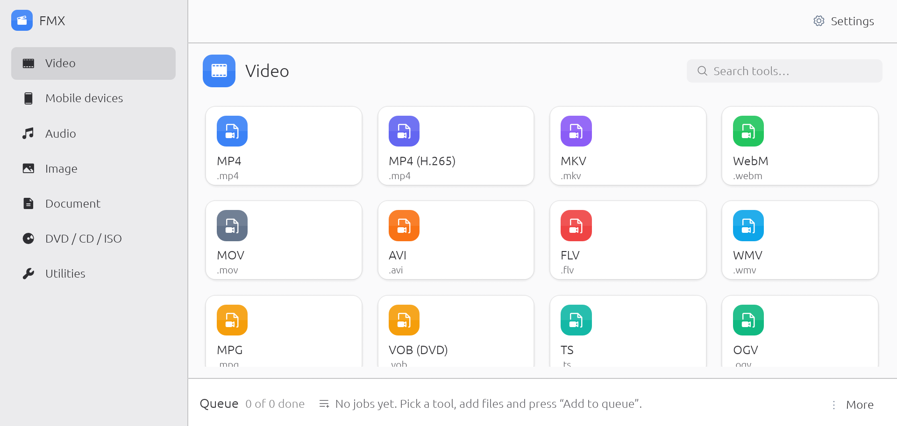
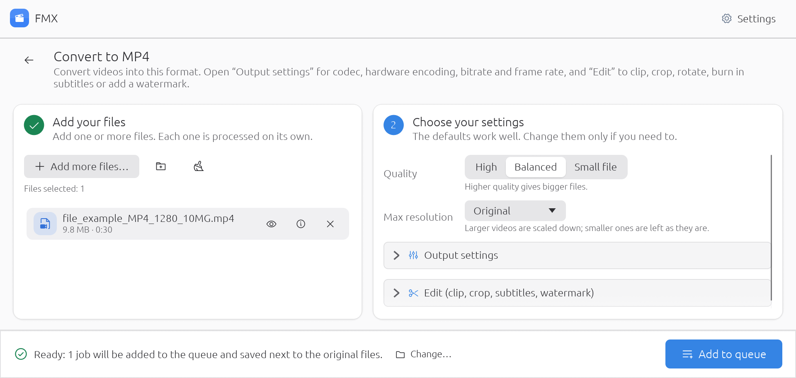
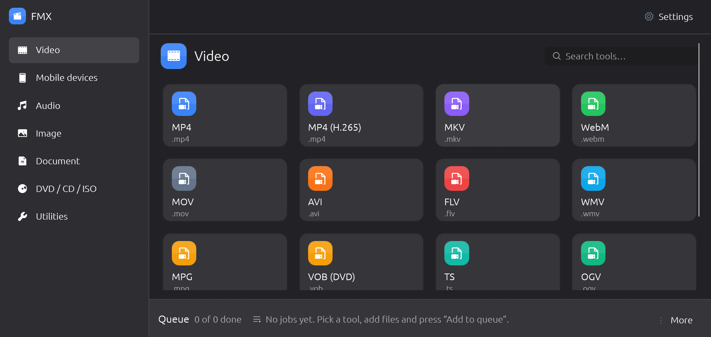

  

  # FMX — Free Media Xpress

  **Convert video, music, pictures, documents and discs — free, simple, and all in one app.**

  
  

  ### [⬇️ Download FMX](https://github.com/sudo-py-dev/fmx/releases/latest)

  Windows · macOS · Linux

  ---

  

## ✨ Why FMX?

- **Everything in one place** — video, music, pictures, PDFs, eBooks and DVDs. No need for five different apps.
- **Nothing extra to install** — everything FMX needs comes inside the download. Install it and start converting.
- **Clean and calm** — a simple, modern window inspired by GNOME and Ubuntu, with smooth animations and no clutter.
- **Light and dark mode** — follows your system, or pick one yourself.
- **Right-click to convert** — choose files in your file manager, right-click, and pick **Convert with FMX**.
- **Many files at once** — add a whole folder; FMX works on several files side by side and shows the progress of each.
- **Speaks your language** — English, Español, Français, Deutsch and עברית.
- **Free, no ads, no account** — open source and free forever.

---

## 🚀 How it works

1. **Pick what you want to make** — choose a category on the left (Video, Audio, Image…) and click a format, like **MP4** or **MP3**.
2. **Add your files** — drag them into the window, or click **Add files**.
3. **Click "Add to queue"** — that's it. Your new files are saved next to the originals (or in a folder you choose).

The default settings work well for most people. If you want more control, open **Output settings** or **Edit** to trim, crop, rotate or add subtitles.

When everything is done, FMX can play a sound, show a notification, open the folder — or even shut down your computer.

---

## 🧰 What can it do?

| | |
|---|---|
| 🎬 **Video** | Convert to MP4, MKV, WebM, MOV, AVI, GIF and more. Trim, crop, rotate, add subtitles or a watermark. |
| 📱 **Phones & devices** | Ready-made settings for iPhone, iPad, Android, smart TVs, YouTube, WhatsApp, PlayStation and Xbox. |
| 🎵 **Audio** | Convert to MP3, M4A, FLAC, WAV, OGG and more. Pull the sound out of any video. Make iPhone ringtones. |
| 🖼️ **Pictures** | Convert to JPG, PNG, WebP and more. Resize, rotate, make black-and-white. Opens iPhone (HEIC) photos. |
| 📄 **Documents** | Pictures → PDF, PDF → Word, Excel or pictures, Word/Excel/PowerPoint → PDF. Merge, split and shrink PDFs. Convert eBooks. |
| 💿 **DVD / CD** | Copy DVDs and Blu-rays to video files, rip music CDs, and make or open ISO disc images. |
| 🔧 **Extras** | Join videos or songs, make a video smaller, change speed or volume, remove a logo, download videos from a link, record your screen. |

<b>See every supported format</b>

**Video:** MP4 (H.264 · H.265) · MKV · WebM · MOV · AVI · FLV · WMV · MPG · VOB · TS · OGV · 3GP · SWF · GIF · Animated WebP

**Audio:** MP3 · AAC · M4A · M4R ringtone · FLAC · WAV · OGG · Opus · WMA · AIFF · AC3 · MP2 · WavPack · MKA · MMF · AMR · APE

**Image:** PNG · JPG · WebP · BMP · TIFF · GIF · ICO · TGA · QOI · AVIF · JPEG XL · PCX

**Documents:** PDF · Word · Excel · TXT · HTML · EPUB · FB2 · MOBI / AZW3 (with Calibre)

**Discs:** DVD · Blu-ray · Music CD · ISO · CSO

---

## 📦 Download and install

Get the file for your computer from the [**latest release**](https://github.com/sudo-py-dev/fmx/releases/latest):

| Your computer | Download | Then |
|---|---|---|
| **Windows 10 / 11** | `…-windows-x64-setup.exe` | Double-click it and follow the steps. |
| **Mac** (Intel or Apple) | `…-macos-universal.dmg` | Open it and drag FMX to Applications. |
| **Ubuntu / Debian** | `…_amd64.deb` | Double-click it to install, or run `sudo apt install ./fmx_*_amd64.deb` |
| **Other Linux** | `…-linux-x86_64.tar.gz` | Unpack it and run `fmx` — no install needed. |

> **Windows says "Windows protected your PC"?** Click **More info → Run anyway**. This appears for new apps that aren't from a big company.
>
> **Mac says FMX "can't be opened"?** Right-click FMX in Applications and choose **Open** the first time.

---

## 🖱️ Convert with a right-click

Select one or more files in your file manager, right-click, and choose **Convert with FMX**:

| Files | You can turn them into |
|---|---|
| Videos | MP4 · MKV · WebM · GIF · MP3 (just the sound) |
| Music | MP3 · M4A · FLAC · WAV · Opus |
| Pictures | JPG · PNG · WebP · PDF (all pictures in one PDF) |
| Word, Excel, PowerPoint | PDF |
| eBooks | PDF · TXT · EPUB · FB2 |
| PDF | Word · TXT · Pictures |

FMX starts right away and saves the new files next to the originals. Choose **Open in FMX** instead if you want to change the settings first.

- **Windows 11:** it's under **Show more options**.
- **Linux:** in Dolphin and Nemo it's in the menu; in Files (Nautilus) and Caja it's under **Scripts**.
- Turn it on or off any time in **Settings → General → Right-click menu**. (Not available on Mac.)

---

## 🌙 Light or dark — your choice

Open **Settings → General → Appearance** and pick **System**, **Light** or **Dark**. If animations bother you, turn on **Reduce motion**.

---

## 🔄 Staying up to date

FMX checks for a new version once a day. When one is ready, a small blue dot appears on **Settings** — open **Settings → Updates** and click **Update now**. Nothing pops up while you work.

Every update is digitally signed, so FMX only installs genuine releases from this page.

---

## ➕ Optional extras

A few tools need a free program that FMX doesn't include because it's very large. If you have it installed, the tool just works; if not, FMX shows it greyed out with a short note.

| To… | Install |
|---|---|
| Turn PDFs into pictures, Word, Excel or text, or merge/split PDFs | Poppler (`poppler-utils`) |
| Make PDFs smaller | Ghostscript |
| Convert Kindle books (MOBI, AZW3) | Calibre |
| Turn a folder into an ISO | xorriso |
| Convert old `.doc` / `.ppt` files | LibreOffice |

You can check what's installed in **Settings → Programs**.

---

## ❓ Something went wrong?

1. Open **Settings → General** and turn on **Debug logging**.
2. Try the same thing again.
3. Click **Open logs folder** and attach the files when you [report the problem](https://github.com/sudo-py-dev/fmx/issues).

If FMX closes unexpectedly, it saves a crash report in the same folder and tells you about it the next time it starts.

**Good to know**

- Copy-protected DVDs and Blu-rays can't be converted.
- On Linux with Wayland, the screen recorder can only record some windows. Log in with an "Xorg" session to record the whole screen.
- On Windows and Mac, choose your language in **Settings → General** (it isn't detected automatically yet).
- On Ubuntu, turn off the right-click menu in Settings *before* uninstalling FMX.

---

## 💙 Free and open source

FMX is free to use, share and change, under the [MIT](LICENSE-MIT) or [Apache 2.0](LICENSE-APACHE) license.

Want to build FMX yourself or help out? See [**DEVELOPMENT.md**](DEVELOPMENT.md).
